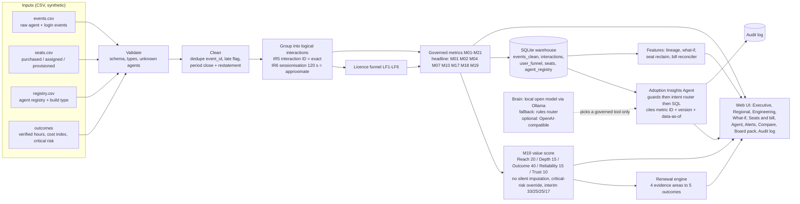

# NimbusPay Adoption Insights

A runnable adoption-analytics product with a governed, read-only AI agent, built for the NimbusPay "Adoption Mirage" case. Its idea: **measure the work, not the clicks.**

> **Hobby case study, synthetic data only.** This is a personal hobby project built for a campus case-study competition (HashedIn by Deloitte Campus PM Hiring 2026, "The Adoption Mirage"). "NimbusPay" is the fictional company from that case brief. Every number, team, user and event here is synthetic and labelled. It is **not affiliated with, endorsed by, or about any real company**, including nimbuspay.io, HashedIn or Deloitte, and contains no real company or personal data.

**Author:** Gowtham S · **Licence:** MIT ·

Every number is illustrative synthetic data that follows the rules in the supporting workbook (metrics M01 to M21, licence funnel LF1 to LF6, interaction rules IR1 to IR8). No real NimbusPay data is used.

## What's in this repo
- **Web UI (v2):** React + Vite + TypeScript + Tailwind source in `web/`. The production build is committed in `app/web/`, so running the app needs no Node.
- **Backend (`app/`):** Python (FastAPI) with a real data pipeline, a local SQLite warehouse, dashboards, alerts, scenario compare, a one-click board pack and an audit log.
- **Adoption Insights Agent:** read-only and governed. Deterministic safety guards run first, every number comes from SQL, and every answer cites its metric ID, version and data-as-of.
- **v1 UI:** kept unchanged in `app/static/` and served at `/legacy`.
- **Branches and tags:**
  - `main`: v2, the current version.
  - `pages-demo`: a static, browser-only build of the v2 UI for GitHub Pages (see Hosting).
  - tag `v1-final`: the version presented before the redesign, kept as a fallback.

## Quick start
Python 3.10+.
```bash
pip install -r requirements.txt
python -m app                     # open http://127.0.0.1:8000
```
Docker (the same image as the Hugging Face Space):
```bash
docker build -t nimbuspay-insights .
docker run --rm -p 7860:7860 nimbuspay-insights    # open http://127.0.0.1:7860
```
Windows PowerShell: `pip install -r requirements.txt; python -m app` (or `.\run_demo.ps1`).

It runs offline with no API key and no paid service. The agent uses a local open model through [Ollama](https://ollama.com) when one is available and falls back to the deterministic rules router otherwise. To force the rules router: `NP_BRAIN=rules python -m app` (same numbers).

Optional fine-tuned router: Gowtham's model is on Hugging Face at https://huggingface.co/Gowthamshivanand/gowtham-nimbuspay-agent. Load it into Ollama as `gowtham-nimbuspay-agent` and run with `NP_BRAIN=finetuned` (details in [docs/MODEL_CARD.md](docs/MODEL_CARD.md) and [finetune/README.md](finetune/README.md)).

Front-end development (only after editing `web/src`, Node 20+): `make web`, or run `python -m app` and, in a second window, `cd web && npm ci && npm run dev` (http://127.0.0.1:5173, proxies `/api` to port 8000).

## Hosting
- **Live agent: Hugging Face Docker Space.** Free CPU, port 7860, rules brain, no secrets. `python tools/make_space.py` builds a text-only upload folder in `dist/hf-space/`; steps in [docs/DEPLOY_HF_SPACES.md](docs/DEPLOY_HF_SPACES.md). The `Dockerfile` also runs on any other Docker host.
- **Static demo: GitHub Pages from the `pages-demo` branch.** `tools/build_pages_demo.sh [out_dir]` builds the v2 UI with `VITE_STATIC=1`. It replays the 874 recorded golden API responses in the browser, so it needs no server, and a banner states that the responses are recorded. The agent there is not live.
- **Offline:** run it on a laptop with `python -m app`; `docs/demo.mp4` is a backup walkthrough video.

The original single-file prototype (`index.html`, built from `src/`) is at tag `v1-final`; the v1 live UI is at `/legacy`.

## Architecture


| Folder / file | What it does |
|---|---|
| `app/pipeline.py` | Ingest, validate, clean, group, funnel, metrics, M19, renewal engine, alerts; loads the SQLite warehouse |
| `app/agent.py` | The agent: safety guards, intent router, SQL-backed answers with citations, optional LLM router |
| `app/server.py` | FastAPI REST API + serves the web UI |
| `app/features.py` | Seat reclaim finder, what-if simulator, metric lineage, vendor bill reconciler |
| `app/config.py` | Every threshold and weight in one place (placeholders, to agree) |
| `web/` | The v2 web UI source: React + Vite + TypeScript + Tailwind. Design tokens in `web/tokens.cjs` (one file) |
| `app/web/` | The v2 UI build, committed, served at `/` and `/assets/*` |
| `app/static/` | The v1 web UI (vanilla JS), kept unchanged as the fallback at `/legacy` (and read by some tests) |
| `app/data/base/` | The v10 workbook's synthetic data as CSVs + the workbook's expected results |
| `app/data/scenarios/` | 8 synthetic scenarios, each a real CSV data set |
| `tools/export_workbook.py`, `tools/make_scenarios.py` | Rebuild the CSVs from the workbook (`make data`) |
| `tests/` | pytest: pipeline, agent, brain, features, API, Playwright UI smoke test |

## Features
| Tab | What it does |
|---|---|
| Data | Load any of the 8 synthetic scenarios, or upload your own events, seats and registry CSVs (validated; bad files are rejected with the reason) |
| Executive | Renewal recommendation with its 4 evidence areas, M19 beside its 5 pillars, 7 more headline metrics, the LF1-LF6 funnel. **Click any metric card to explain the number.** |
| **Explain this number (lineage)** | For any metric: formula, version, owner (proposed role), freshness (data-as-of, late rows, restatement), source tables, pipeline steps, missing-data rule, tests, and the SQL, re-run live on the warehouse |
| **What-if** | Renewal simulator: change the seat count at renewal, fix connector failures, or raise interaction-ID coverage. It re-runs the full pipeline and shows today vs what-if for the funnel, M19 pillars and renewal outcome. It is not a forecast. |
| **Seats and bill** | **Seat reclaim finder**: never-assigned and idle seats by team, with 10% headroom kept, and a reclaim figure at a placeholder price (100 price units a seat, labelled synthetic). Team-level only. **Vendor bill reconciler**: upload the vendor invoice CSV (sample in `app/data/samples/vendor_invoice_sample.csv`) to compare billed vs purchased vs assigned vs active seats per team. Overbilling, unknown teams, unassigned billed seats and missing teams are flagged. |
| Regional | Funnel and M01, M02, M11 by region; teams under 5 assigned seats are suppressed |
| Engineering | M10, M11, M12, M16, M20; agent registry with build type and its source (registry or backfill) |
| Agent | Read-only chat with the 21 golden questions as chips; the brain shown in the header; citations, SQL, refusals with safe alternatives. Answers **stream in** (typing effect) and each one shows **which brain answered** (rules, Ollama, fine-tuned, hosted LLM), its **latency in ms** and a **confidence**. **Follow-ups** work ("and Region B?", "what about the fraud one?", "what about last month?"). Vague asks get a **clarifying question** with 2-3 clickable options. **Why this number?** opens one panel with the SQL run, the metric definition, ID and version, data-as-of and rows returned. **Thumbs up/down** on every answer. **Ask as Manager / Analyst / Guest** re-asks the same question under another role |
| **Role switch** (header) | Manager, Analyst (Region A) and Guest buttons plus every persona in the dropdown. The UI only sends a role name; scope and deny-by-default are enforced on the server (an unknown or mistyped role is Guest) |
| **Models** | Model comparison: the same agent test per brain (rules always; the stock Ollama model and the fine-tuned model only if reachable, otherwise **not available**, never estimated). Golden, panel and extra scores, unsafe answers, number faithfulness, p50/p95 latency, release gate. Load a saved `tools/eval_agent.py --save` JSON from another machine |
| Alerts | Rule-based alerts from the governed metrics |
| Compare | All 8 scenarios side by side |
| Board pack | One click: printable HTML (save as PDF) or Markdown |
| Audit log | Every agent question with persona, result, metrics cited and brain |

The v2 UI follows the Figma hi-fi tokens (light consulting, Apple-clean): white and neutral greys (`#4B5563` secondary text), navy `#0B2E59` for primary actions and selected states, orange `#E8751A` only as a fill (bars, markers) and `#C2410C` for orange text, teal `#0F5E63` only for verified items, Inter (system font fallback, no font files shipped), 150-180 ms transitions, WCAG AA contrast. Red is used only for critical risk. Every value lives in `web/tokens.cjs`. (The v1 UI at `/legacy` keeps the deck brand: charcoal, orange `#F28C28`, Arial.)

## The agent and its brain
- **Safety guards are always deterministic** and run first. There are 9: prompt injection, individual surveillance, raw events or PII, small groups (< 5), out-of-scope regions (row-level security by persona), forecasts, causal claims, writes or actions, and ungoverned metrics are refused with a safe alternative. After the answer, a **claim check** means the agent never confirms a number the user typed unless its own SQL computed the same figure. Anything it can't match is never guessed: it says so and offers the 3 closest governed questions it can answer.
- **Deny by default on role.** A missing or unrecognised persona resolves to the least-privileged `guest` role (no data scope; definitions only), in the API, the agent and the static prototype. It never falls back to Executive. In production the role is an SSO token claim, not a request field.
- **Broad but governed coverage.** Beyond the 21 golden questions it answers panel-style paraphrases: a named agent's health or time saved (M17 study status plus its governed usage), reliability by agent, which agents are used most, engineer-built vs drag-and-drop, team usage (teams under 5 seats suppressed), region comparison, weekly trend inside the closed period, data freshness, alerts, seat reclaim, and outcome metrics that need study data (M06 to M09, refused with the reason).
- **The brain only routes.** It picks one governed tool (for example `m01`, `m19`, `renewal`). The tool then runs real SQL on the warehouse and returns the answer with metric ID + version + data-as-of and the SQL. The model never states a number.
- **Default brain: a small open model running locally at zero cost through [Ollama](https://ollama.com).** If Ollama isn't reachable, or the model returns anything outside the tool list, the agent falls back automatically to the **deterministic rules router**, which covers everything on its own. The chat header shows which brain is active.

| Brain | When it is used | Setup |
|---|---|---|
| Open model (default when available) | Ollama answers at `OLLAMA_HOST` and `OLLAMA_MODEL` is pulled | Install Ollama, then `ollama pull qwen2.5:3b-instruct` (about 2 GB) or `ollama pull llama3.2:3b`. On a low-memory laptop use `qwen2.5:1.5b-instruct` or `qwen2.5:0.5b-instruct` and set `OLLAMA_MODEL` to match. |
| OpenAI-compatible API (optional) | No Ollama, and `LLM_API_KEY` or `OPENAI_API_KEY` is set | Optional `LLM_BASE_URL`, `LLM_MODEL` |
| Fine-tuned router (opt-in) | `NP_BRAIN=finetuned` and `FT_MODEL` (default `gowtham-nimbuspay-agent`) is in Ollama | Train it on a free Colab T4 with [`finetune/`](finetune/README.md), then `ollama create gowtham-nimbuspay-agent -f Modelfile`. It ships only if it passes the release gate. Hybrid by default: guards and confident rules matches stay on rules, the model only routes the questions rules can't place (`FT_MODE=pure` to compare; settings in the finetune README). |
| Rules engine (always available) | Otherwise, or `NP_BRAIN=rules` | Nothing |

**Evaluate whichever brain is active:** `python tools/eval_agent.py` (or `--brain rules|ollama|openai`) runs the 21 golden questions, 8 guard and paraphrase probes, and the 64-question unscripted probe set in `tests/data/probes.json` (a 24-question panel set with 17 should-answer and 7 should-refuse, plus 40 extra paraphrases, adversarial asks and role checks), and prints the pass rates. The rules brain scores 21/21 on the golden questions, 29/29 on the guard probes, 24/24 on the panel set and 40/40 on the extras. If a model brain scores lower, run with `NP_BRAIN=rules`.

## Scenarios (real CSV data through the same pipeline)
| Scenario | What changes in the data | Renewal outcome |
|---|---|---|
| Baseline | The workbook's 210-row set | Renew and right-size (M01 69.6% < 70%) |
| Healthy adoption | Idle seats activated weekly | Expand |
| Overstated usage | Everyone logs in, few return, high unit cost | Renegotiate |
| Shelfware | 6 users stop, purchased seats grow | Renew and right-size |
| New-country launch | New Region D cohort, no verified study yet | Continue limited pilot |
| Reliability incident | Drag-and-drop connector calls fail | Renew with remediation conditions |
| Missing interaction IDs | SDK drops IDs, all sessionised, impact not attributable | Continue limited pilot |
| Critical-risk breach | Card data outside the masked zone | Renew with remediation conditions (score RED) |

Upload your own `events.csv`, `seats.csv` and `registry.csv` on the **Data** tab (download any scenario's CSVs there as a template).

## What the pipeline proves (asserted in `tests/test_pipeline.py`)
On the workbook's extended synthetic set it reproduces **all 35 Expected_Results_Extended values exactly**: 210 raw rows, 6 duplicates, 4 after close, 200 clean events, 44 interactions (22 exact, 22 approximate), 43 qualifying, vendor-style MAU 21 vs 16 active (31.2% overstatement), funnel 31 / 23 / 22 / 16 / 11 / 6, M01 69.6%, M02 26.1%, M10 4.3%, M11 17.5%, M20 0% vs 100% by build type, 1 unregistered agent, regional funnels and the restatement. On the 9-event golden set: 9 events = 2 interactions (4.5x). All synthetic.

## How it maps to the case deliverables
| Case ask | Where it lives in the product |
|---|---|
| Define adoption properly (interactions, not events) | `pipeline.compute_core`: IR5 exact + IR6 approximate, qualifying = run + response; Data and Engineering tabs |
| Licence funnel and shelfware | LF1-LF6 on the Executive tab; regional funnels with small-group suppression |
| Governed metric set | M01-M21 dictionary (`src/data.json`), 8 headline metrics computed in `pipeline.run`, each with ID + version |
| AI value score | M19 with 5 pillars, no silent imputation, critical-risk override, interim index |
| Dashboards for each persona | Executive, Regional adoption and intervention, Engineering reliability |
| Adoption Insights Agent | `app/agent.py`: 21 golden questions, refusals, SQL, citations, audit log |
| Renewal decision | Renewal engine (4 evidence areas to 5 outcomes), Compare tab, board pack export |
| Trust and governance | Read-only agent, persona scope, PII guards, audit log, metric versions, data-as-of, restatement |

## Tests
```bash
pip install -r requirements-dev.txt
make test        # pytest suite, then the agent release gate (tools/eval_agent.py --brain rules) and the break-it set (tools/break_it.py)
make test-ui     # Playwright browser tests (need Chrome or Chromium; set CHROME_PATH if it isn't at /usr/bin/google-chrome)
```
Last verified run (20 Oct 2026): **390 passed, 1 skipped**; release gate 21/21 golden, 29/29 guard probes, 24/24 panel, 40/40 extras; break-it 22/22. GitHub Actions (`.github/workflows/tests.yml`) runs the same pytest suite, release gate and break-it set on every push and pull request.

## Docs
- [docs/BREAK_IT.md](docs/BREAK_IT.md): 22 adversarial questions and the real responses (`python tools/break_it.py`)
- [docs/MODEL_CARD.md](docs/MODEL_CARD.md): the fine-tuned router's intended use, data and release gate
- [docs/DEPLOY_HF_SPACES.md](docs/DEPLOY_HF_SPACES.md): deploy the live agent to a free Hugging Face Docker Space
- [docs/RUNBOOK.md](docs/RUNBOOK.md): SLOs, alerts, on-call playbooks, rollback and the release flow
- [docs/DEMO_SCRIPT.md](docs/DEMO_SCRIPT.md): the 4-minute demo script
- [CHANGELOG.md](CHANGELOG.md): what changed in v2

## Screenshots
Captured from the v1 UI; v2 shows the same screens, numbers and agent answers in the new design.


## Sources for synthetic ranges and definitions
These are used only to keep synthetic values plausible. No figures are copied as NimbusPay data.
- GitHub Docs, *Tracking license activation and initial usage*: healthy early adoption is about 60 to 80% of assigned users active in the first month. https://docs.github.com/en/copilot/tutorials/roll-out-at-scale/assign-licenses/track-usage-and-adoption
- GitHub Docs, *Interpreting usage and adoption metrics*: a WAU-to-licence ratio above 60% indicates strong usage. https://docs.github.com/en/copilot/reference/copilot-usage-metrics/interpret-copilot-metrics
- GitHub Docs, *Copilot usage metrics*: engaged means 2+ distinct days in 28. https://docs.github.com/en/copilot/reference/copilot-usage-metrics/copilot-usage-metrics
- Microsoft Learn, *Microsoft 365 Copilot usage report*: active users ÷ enabled users; opening a pane is not use. https://learn.microsoft.com/en-us/microsoft-365/admin/activity-reports/microsoft-365-copilot-usage
- Microsoft Learn, *Copilot adoption report (Viva Insights)*: a habitual user is active in 9 of 12 weeks. https://learn.microsoft.com/en-us/viva/insights/advanced/analyst/templates/microsoft-365-copilot-adoption
- Faros AI blog: high performers reach about 80% MAU and 60% DAU after six months (vendor blog; treat with care). https://www.faros.ai/blog/increase-github-copilot-adoption-and-usage-best-practices

## Credits
Concept, case solution and prototype: **Gowtham S**. Definitions come from his supporting workbook for the NimbusPay case. Not affiliated with NimbusPay (a fictional case company), HashedIn or Deloitte.
